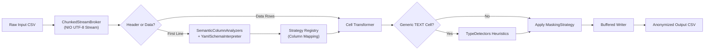

# 🛡️ Sentinel Data Anonymizer

[](https://openjdk.org/)
[](https://maven.apache.org/)
[](https://junit.org/junit5/)
[](LICENSE)
[-brightgreen.svg)]()

**Sentinel Data Anonymizer** is a high-performance, memory-efficient data masking and PII (Personally Identifiable Information) anonymization engine written in pure Java. It processes structured tabular datasets (such as CSV files) line-by-line in a streaming fashion, guaranteeing near-zero memory footprint (< 50MB RAM) regardless of file size (from megabytes to multi-gigabytes).

---

## 📋 Table of Contents

- [Key Features](#-key-features)
- [Architecture & Design](#-architecture--design)
- [Masking Strategies](#-masking-strategies)
- [Prerequisites](#-prerequisites)
- [Quick Start](#-quick-start)
  - [1. Running Directly from IDE (VS Code, IntelliJ, Eclipse)](#1-running-directly-from-ide-vs-code-intellij-eclipse)
  - [2. Self-Demonstration Mode via CLI](#2-self-demonstration-mode-via-cli)
  - [3. CLI Production Usage](#3-cli-production-usage)
- [Configuration Schema (YAML)](#-configuration-schema-yaml)
- [Testing & Quality Assurance](#-testing--quality-assurance)
- [Project Structure](#-project-structure)
- [License](#-license)

---

## ✨ Key Features

- **⚡ Zero Runtime Dependencies:** Built purely on standard Java (`java.nio.file`, `java.security.MessageDigest`, `java.nio.charset`). No external runtime libraries required.
- **🚀 Streaming Pipeline:** Constant memory consumption (`< 50MB RAM`) utilizing forward-only `try-with-resources` buffered stream brokers. Large CSV files will never cause `OutOfMemoryError`.
- **🧠 Semantic Column Analysis:** Automatically categorizes columns based on header naming heuristics (`email`, `card`, `phone`, `user_id`, `name`).
- **🔍 Dynamic Fallback Heuristics:** If a column is generic `TEXT`, cell-level pre-compiled regex detectors dynamically identify and anonymize sensitive values on the fly.
- **🛠️ Pluggable Strategy Pattern:** Modular design allowing strategies (`CryptographicHash`, `CharScrambler`, `RegExBlur`) to be extended and customized easily.
- **📄 Declarative Configuration:** Easily configure masking strategies via a lightweight key-value YAML schema (`schema_config.yaml`).
- **🌐 Broad Compatibility:** Fully compatible with Java 8, 11, 17, and 21+.

---

## 🏛️ Architecture & Design



---

## 🎭 Masking Strategies

| Strategy | Description | Original Example | Anonymized Result |
| :--- | :--- | :--- | :--- |
| **`HASH`** (`CryptographicHash`) | Deterministic SHA-256 hex digest (UTF-8). Preserves relational consistency across tables. | `John Doe` | `6cea57c2fb6cbc2a4041...37f908` |
| **`SCRAMBLE`** (`CharScrambler`) | Replaces letters with `X` and digits with `9`, preserving separators (dashes, spaces). | `1234-5678-9012-3456` | `9999-9999-9999-9999` |
| **`REGEX`** (`RegExBlur`) | Obscures characters using regular expressions (e.g. email username blurring, phone masking). | `john.doe@example.com`<br>`+1-555-0199` | `jo******@example.com`<br>`+*-***-0199` |
| **`TEXT`** (Identity) | Fallback passthrough; leaves non-sensitive data untouched. | `Active VIP customer` | `Active VIP customer` |

---

## 📦 Prerequisites

- **Java Development Kit (JDK) 8** or higher (Java 8, 11, 17, 21+)
- Optional: Apache Maven 3.6+

---

## 🚀 Quick Start

### 1. Running Directly from IDE (VS Code, IntelliJ, Eclipse)

1. Open the project folder in your IDE.
2. Open `src/main/java/com/engine/anonymizer/Main.java`.
3. Click **Run** or **Debug**.
4. The application will start in self-demonstration mode:
   - Generates demo `sample_input.csv`
   - Generates demo `schema_config.yaml`
   - Processes and creates `sample_output_anonymized.csv`

### 2. Self-Demonstration Mode via CLI

If you have Maven installed:
```bash
# Build the project
mvn clean package

# Run the packaged executable JAR
java -jar target/sentinel-data-anonymizer-1.0-SNAPSHOT.jar
```

Or run directly without packaging:
```bash
# Compile
javac -d target/classes src/main/java/com/engine/anonymizer/**/*.java

# Run
java -cp target/classes com.engine.anonymizer.Main
```

**Console Output:**
```text
=================================================
   Sentinel Anonymous Smart Data Masking Utility 
=================================================
No command line parameters found. Running self-demonstration...
Generated demo schema configuration: schema_config.yaml
Generated demo source CSV dataset: sample_input.csv
Interpreting configuration schema: schema_config.yaml
  Registered Strategy: PHONE -> REGEX
  Registered Strategy: EMAIL -> REGEX
  Registered Strategy: CREDIT_CARD -> SCRAMBLE
  Registered Strategy: NAME -> HASH
Pipeline started. Source: sample_input.csv -> Destination: sample_output_anonymized.csv
  Column Mapping: [id] is analyzed as TEXT
  Column Mapping: [customer_name] is analyzed as NAME
  Column Mapping: [email_address] is analyzed as EMAIL
  Column Mapping: [credit_card_no] is analyzed as CREDIT_CARD
  Column Mapping: [phone_no] is analyzed as PHONE
  Column Mapping: [comments] is analyzed as TEXT
Pipeline completed successfully!
=================================================
Masking Operation Finished!
=================================================
```

### 3. CLI Production Usage

You can supply your own CSV files and an optional configuration YAML:

```bash
java -jar target/sentinel-data-anonymizer-1.0-SNAPSHOT.jar <input_csv> <output_csv> [schema_config.yaml]
```

**Example:**
```bash
java -jar target/sentinel-data-anonymizer-1.0-SNAPSHOT.jar my_customers.csv masked_customers.csv schema_config.yaml
```

**Help Flag:**
```bash
java -jar target/sentinel-data-anonymizer-1.0-SNAPSHOT.jar --help
```

---

## ⚙️ Configuration Schema (YAML)

You can customize which strategy applies to each semantic category by creating a `.yaml` file:

```yaml
# schema_config.yaml
EMAIL: REGEX
CREDIT_CARD: SCRAMBLE
NAME: HASH
PHONE: REGEX
```

Supported strategy keys:
- `HASH`: Cryptographic SHA-256
- `SCRAMBLE`: Alphanumeric character replacement
- `REGEX`: Pattern-based character blurring
- `TEXT`: Unmasked passthrough

---

## 🧪 Testing & Quality Assurance

Unit tests can be executed either via JUnit 5 or via the built-in standalone test runner (`MainTestRunner`):

```bash
# Run tests directly via Java without any external test runner
java -cp "target/classes;target/test-classes" com.engine.anonymizer.MainTestRunner

# Or via Maven
mvn test
```

---

## 📂 Project Structure

```text
sentinel-data-anonymizer/
├── src/
│   ├── main/java/com/engine/anonymizer/
│   │   ├── Main.java                        # Entry point & CLI handler
│   │   ├── config/
│   │   │   ├── ProfileConfigurationRegistry.java  # Category-to-strategy mapping
│   │   │   └── YamlSchemaInterpreter.java         # Lightweight YAML configuration parser
│   │   ├── detector/
│   │   │   ├── SemanticColumnAnalyzers.java       # Column header semantic analyzer
│   │   │   └── TypeDetectors.java                 # Regex heuristics for cell data
│   │   ├── io/
│   │   │   ├── ChunkedStreamBroker.java           # Memory-bounded line streamer (NIO)
│   │   │   └── NonBlockingFilePipeline.java       # Transformation pipeline coordinator
│   │   └── strategy/
│   │       ├── MaskingStrategy.java               # Functional interface for strategies
│   │       ├── CharScrambler.java                 # Format-preserving scrambler
│   │       ├── CryptographicHash.java             # UTF-8 SHA-256 implementation
│   │       └── RegExBlur.java                     # Regular expression masker
│   └── test/java/com/engine/anonymizer/
│       ├── AnonymizerTest.java                    # JUnit 5 unit tests
│       └── MainTestRunner.java                    # Standalone test runner
├── .gitignore                  # Git ignore rules for Maven & IDEs
├── pom.xml                     # Maven project configuration
├── sample_input.csv            # Sample input dataset
├── sample_output_anonymized.csv# Example anonymized output
├── schema_config.yaml          # Sample YAML schema configuration
└── README.md                   # Project documentation
```

---

## 📄 License

This project is licensed under the [MIT License](LICENSE).
